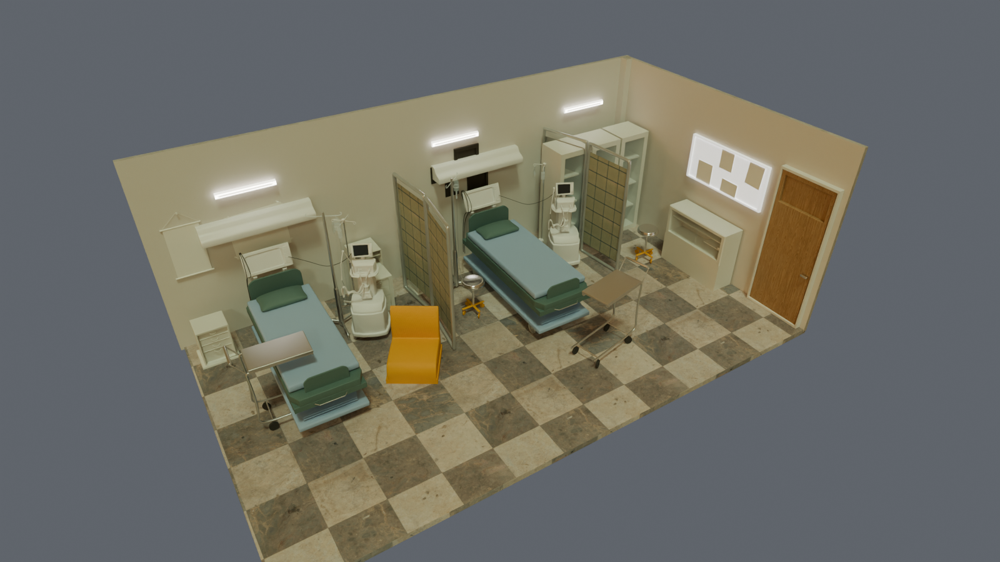

# apps/twin3d (owner: B)

The 3D view of the ward. **Polish, display only** ([ADR 0012](../../docs/decisions/0012-3d-twin.md)).
The 2D board stays the demo fallback. It never decides or changes anything: it only shows what
the server's WebSocket (`/api/v1/wards/W1/stream`) already says, and stale data looks stale
(safety invariant 5: bedside monitor shows "no signal", never a calm number).

## Status

| Part | State |
|---|---|
| Blender scene: Room B at real size, 2 beds, walls and ceiling, bedside kit, PBR materials | **done** (this folder: `blender/01..04`) |
| Corridor, nurse station, 6 rooms placed from the seed, call lights, station TV | planned, see "Layout" |
| Lighting bake (Cycles + OptiX) and `.glb` export (Draco + KTX2) | not started |
| React Three Fiber app (`src/`) | not started |
| Poly Haven textures (7 materials) and the hospital HDRI | **done**, wired into `04_materials.py` |
| Nurses, patients, station and corridor props | waiting on downloads, see [ASSETS.md](ASSETS.md) |

## How the pipeline works (the part to explain to the judges)

```
Blender scene  --bpy scripts-->  ward .blend  --bake lighting-->  ward.glb  -->  React Three Fiber
 (2 source rooms)  (blender/*.py)   (Cycles/OptiX)   (Draco+KTX2)      (reads WebSocket)
```

1. **Why Blender and not a game engine.** Everything is built by Python scripts that anyone can
   re-run, from a seed file we already have. No editor clicking, so the build is reproducible.
2. **Why bake.** Real-time lighting in a browser is cheap but flat. We compute the light once on
   the RTX 4060 (Cycles, OptiX) and store it in textures, so any laptop shows soft shadows.
3. **Why `.glb`.** One file, PBR materials (glTF metallic-roughness), loads in three.js.
4. **Why the screens are separate meshes.** The monitor body is static geometry; the screen is a
   flat quad named `screen_monitor` whose texture the web app replaces with live values.



## The Blender scripts (`blender/`)

Run them in order inside Blender (Scripting tab or the Blender MCP), or all at once on a
**copy** of your scene, headless:

```bash
"C:/Program Files/Blender Foundation/Blender 5.1/blender.exe" --background rooms.blend \
  --python apps/twin3d/blender/build_ward.py
```

Textures (once, after downloading Poly Haven `.blend.zip` bundles and unzipping each into its own
folder under `<unzipped>`):

```bash
"C:/Program Files/Blender Foundation/Blender 5.1/blender.exe" --background   --python apps/twin3d/blender/prepare_textures.py -- <unzipped> <borj-assets>/textures
```

| Script | What it does | Why |
|---|---|---|
| `01_fix_scale_and_archive.py` | Scales room "Hospital" ×7 to real metres (bed 2.05 m, door 0.8 × 2.0 m, ceiling 2.56 m). Moves `lab_tools` (700k triangles of syringes, an apple...) and `dead_body1` (a covered figure on a stretcher) into a hidden collection. | The file was 1/7 of real size. A figure under a sheet reads as a corpse; it must not be in a patient room. Nothing is deleted. |
| `02_second_bed_and_shell.py` | Adds a second bed (linked copy: same mesh, no extra size) where the stretcher was; adds the missing east wall, south wall and ceiling as separate boxes tagged `twin_cutaway`. | Every seed room has 2 beds. The room had 1 bed and no walls on two sides. The web view hides walls facing the camera. |
| `03_bedside_kit.py` | Copies a monitor cart, IV pole and headwall unit out of room "Sketchfab_model" (room A, untouched), decimates them (200k to ~65k triangles per bed), builds a `screen_monitor` quad on the real display face, and places one kit beside each bed. | Room B has no monitor at all, and the twin needs one per bed. |
| `04_materials.py` | Replaces the single flat grey with a table of PBR materials (colour, roughness, metallic, glass, emission) assigned by part name or size. Image maps from `borj-assets/textures/` are used when present (floor, walls, door, mattress, linen, curtains, armchair); a `tint` multiplies a map's colour. | glTF is PBR; flat grey would bake into a dull model. |
| `prepare_textures.py` (tool, not a scene step) | Turns the Poly Haven `.blend.zip` bundles into 3 plain 8-bit maps per material (colour jpg, roughness, OpenGL normal png) and checks each conversion by reading it back. | The bundles mix `.exr` and `.png`, and carry maps glTF cannot use (displacement, AO). KTX2 compression later wants plain images. |

`common.py` holds three small helpers (subtree, bounding box, linked copy). Each script is
re-runnable. Original materials and objects are kept in the file; the original two rooms are
backed up at `Desktop\borj-assets\backup\rooms-original.blend` (outside the repo).

## Layout plan: how the rooms fit `seed/ward-W1.yaml`

The seed has **6 rooms, 12 beds (B01 to B12)**, a station at x = 0 and positions in metres along
the corridor. Our room is 3.95 m wide (x) and 6.96 m deep (y), the door is on the back wall.

- **Corridor** along x from -15 to +15 m, 2.4 m wide (y between -1.2 and +1.2), station at (0, 0).
- **Room x** = the seed x, measured at the **door** (so walking distance in 3D matches the
  server's proximity numbers). R1 -12, R2 -6, R3 +6, R4 +12 (north side), R5 -9, R6 +9 (south side).
  Neighbouring rooms are 6 m apart and 3.95 m wide, so there is a 2 m wall gap.
- **Room y**: the seed says 4 (schematic). In 3D, a 6.96 m deep room beside a 2.4 m corridor puts
  the room centre at |y| = 4.68. The server keeps using the seed numbers; the twin is display only.
- **Orientation**: north rooms (R1 to R4) are turned 180 degrees about Z so the door faces the
  corridor; south rooms (R5, R6) are not.
- **Beds**: `bed:All_bed` is the first bed of the room, `bed2:All_bed` the second
  (B01/B02 in R1, B03/B04 in R2 ... B11/B12 in R6). Each gets `twin_bed_id` as a custom property.
- **Device profile from the seed drives the screen**, not the model: B09 and B11 (oximeter only)
  show SpO2 and pulse; B12 (`none`) shows "no device"; B03 and B08 show "RR missing". The same
  monitor mesh is used for all (absent is shown as absent, invariant 5).
- **Names the web app will look up** (contract with the exporter): `screen_<bedId>`,
  `callLight_<bedId>`, `tv_station`, plus `twin_cutaway` on walls and ceilings.
- **Triangle budget**: ~260k per room today, so 6 rooms are ~1.6M. The export step merges meshes by
  material and decimates further; target under 800k for the whole ward.

## Next steps

1. Corridor, nurse station and TV (own geometry, no downloads), call lights, 6 rooms assembled from the seed.
2. Real textures and HDRI when downloaded (see [ASSETS.md](ASSETS.md)); nurses and patients.
3. Bake lighting, export `.glb`, record sizes.
4. `src/`: React Three Fiber scene, WebSocket client, glow by NEWS2 band, "no signal" for stale data.
