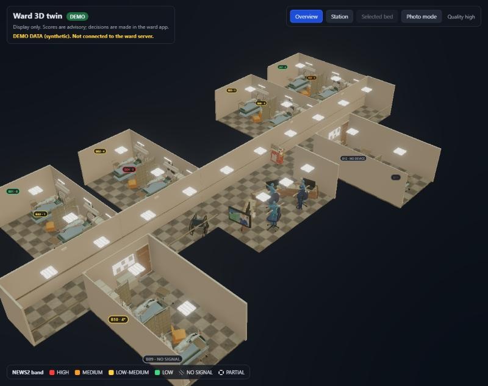
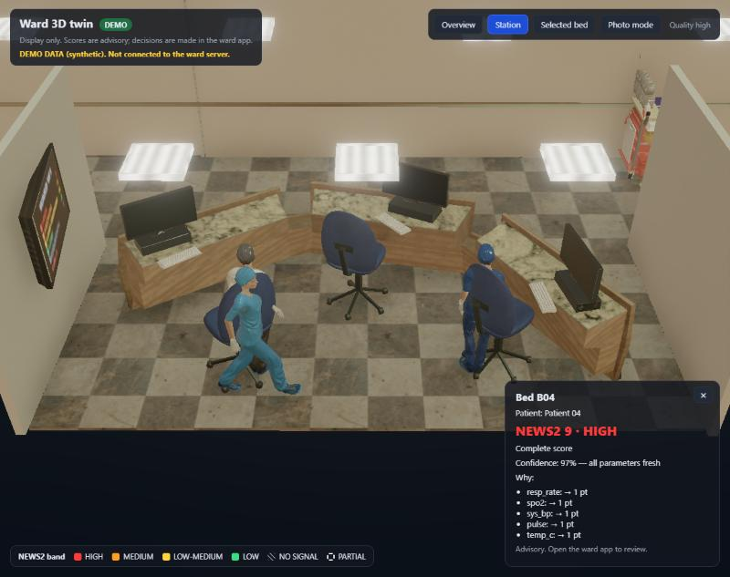
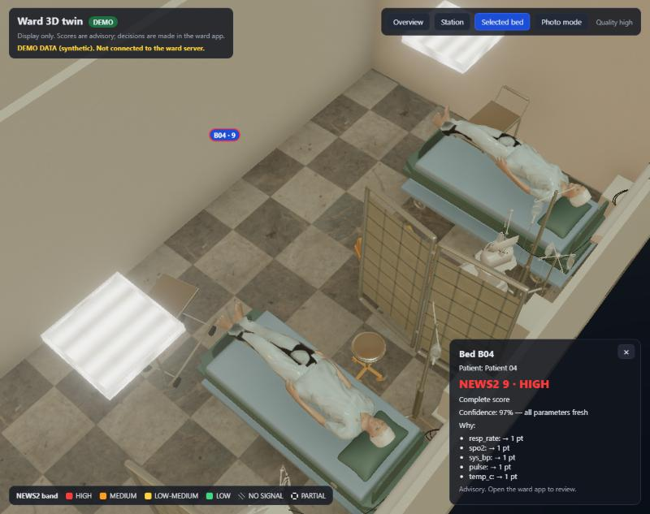
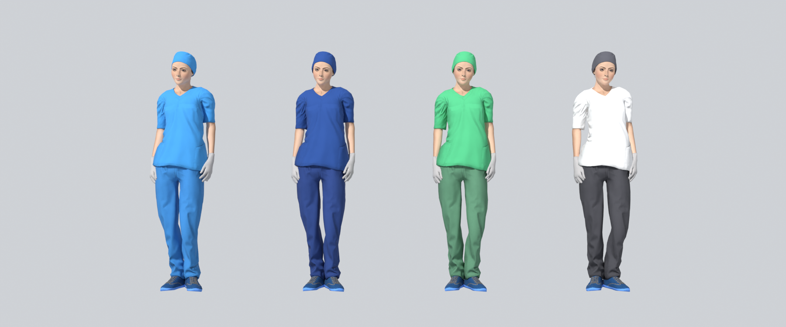

# apps/twin3d (owner: B)

The 3D view of the ward: the digital twin you can walk around. **Display only**
([ADR 0012](../../docs/decisions/0012-3d-twin.md), [ADR 0014](../../docs/decisions/0014-twin3d-delivery.md)).
It reads the ward server's WebSocket stream and draws it. It never changes anything, and a test fails if
the code ever sends a request other than the login. The 2D board in `apps/ward` stays the reliable demo view.







## What it shows

| Stream data (`contracts/openapi.yaml`) | In the 3D ward |
|---|---|
| `bed.news2` (band, total, complete, stale, missing) | The bed's monitor: score and band label, glowing in the band colour. A score from incomplete input carries a dashed **PARTIAL** tag (invariant 5) |
| No fresh readings, or the device stopped | The monitor says **NO SIGNAL** (grey, hatched), never a calm number. A bed with no device says **NO DEVICE**; an unavailable score says **SCORE UNAVAILABLE** |
| `bed.admission` null | The patient is not in the bed and the monitor is dark (**VACANT**) |
| `call` (pressed, sent, not_sent, acknowledged, escalated) | The bed's call light and the room's door light pulse (fast when escalated, steady amber once acknowledged) |
| `call.acknowledgedBy` | That staff member stands up, walks out of the station, along the corridor, into the room to the bedside, and goes back when the call resolves |
| `staff.onWard` / `onShift` | The figure appears or disappears |
| Counts of beds per band, open calls | The wall TV at the station |
| Click a bed (or its label) | A panel with the score, the **confidence and its basis**, the reasons (invariant 12) and an "advisory" line. Review and decisions happen in the ward app |

Also: camera presets (overview, station, selected bed), orbit and zoom, walls and ceilings that face the
camera hide themselves (doll-house view), adaptive quality, and a photo mode (maximum quality, save as PNG).

## Run it

```bash
npm install                       # from the repo root (it is an npm workspace)
npm run dev:server                # the ward server (the mock one, port 8000)
npm run dev:twin                  # http://localhost:5175, proxies /api to the ward server
```

Sign in with a staff id and PIN (the mock accepts any). **`?demo=1`** opens a synthetic stream instead, for
screenshots or when no server is running. It is labelled **DEMO DATA** on screen and is never used unless asked for.
On a machine where port 8000 is reserved (it happens on Windows), put `TWIN_API_TARGET=http://localhost:8010`
in `apps/twin3d/.env.local` (git ignores it) and run the server there.

```bash
npm run lint --workspace=apps/twin3d    # type check + 14 tests
npm run build --workspace=apps/twin3d   # production build (also runs in CI)
```

## How it works (read this before the demo questions)

```
Blender scripts (blender/*.py) --> public/models/{ward.glb, staff.glb, ward-layout.json}
                                                  |
 login + WebSocket (net/connection.ts) --> logic/wardStore.ts (state) --> scene/WardModel.tsx, Staff.tsx --> screen
```

- **Why a store with pure functions** (`src/logic/`). The rules that matter for safety are plain functions with
  tests: `monitor.ts` decides what a monitor shows (stale or missing is never shown as normal),
  `wardStore.ts` applies stream messages (replaying a message changes nothing; an older bed message never
  overwrites a newer one), `paths.ts` routes staff along the corridor.
- **Named nodes.** The Blender build names the things the app drives (`screen_B01`, `callLight_B01`,
  `callLightDoor_R1`, `patient_B01`, `screen_tv_station`, nodes with a `twin_cutaway` normal). The app finds them
  by name, gives each its own material, and draws a canvas texture on every screen.
- **Staff are one model, recoloured.** `staff.glb` holds one skinned nurse with nine clips (`idle`, `walk`,
  `type`, `talk`, `sit_idle`, `sit_to_stand`, `stand_to_sit`, `sit_to_type`, `type_to_sit`). The app clones it per
  person (`SkeletonUtils.clone`) and sets the colours of `nurse_top`, `nurse_bottom` and `nurse_hat` from the role.
  Movement is derived from the stream (who acknowledged which call); **the contract has no staff coordinates**, so
  this shows who is answering which call, not where anyone really is.
- **Quality adapts.** drei's `PerformanceMonitor` steps between plain, bloom, bloom with ambient occlusion
  (N8AO), and photo mode (maximum resolution and samples) so a weak laptop stays smooth.
- **Look.** Image-based lighting from a hospital HDRI, N8AO ambient occlusion, bloom on the glowing screens, AgX tone mapping.



## Sizes (measured)

| File | Size | Notes |
|---|---|---|
| `models/ward.glb` | 10.4 MB | 414 nodes, ~526k polygons counted per node (the six rooms share one mesh set), Draco geometry, WebP textures |
| `models/staff.glb` | 2.5 MB | 35k polygons, 65 bones, 9 clips |
| `models/ward-layout.json` | 6 KB | every anchor the app needs |
| `hdri/hospital_1k.hdr` | 1.4 MB | CC0 `childrens_hospital`, scaled to 1K |
| JS bundle | 479 KB gzipped | three.js, React, the app |

## The model pipeline (`blender/`)

Reproducible, so the ward can be rebuilt from the two source rooms and `seed/ward-W1.yaml`. Run all of it, headless, on a
**copy** of your scene (nothing is saved unless you pass `--save`):

```bash
"C:/Program Files/Blender Foundation/Blender 5.1/blender.exe" --background rooms.blend \
  --python apps/twin3d/blender/build_ward.py
```

Assets live outside the repo in `Desktop\borj-assets\` (see [ASSETS.md](ASSETS.md); licences in [CREDITS.md](CREDITS.md)).
Textures are first converted once with `prepare_textures.py`.

| Script | What it does and why |
|---|---|
| `01_fix_scale_and_archive.py` | Room "Hospital" was built at 1/7 of real size (bed 0.29 m): scale it to metres. Hide (not delete) the 700k-triangle `lab_tools` and the covered-figure stretcher |
| `02_second_bed_and_shell.py` | Every seed room has two beds, the room had one: add a linked copy. Add the missing east wall, south wall and ceiling as separate cut-away pieces |
| `03_bedside_kit.py` | The room had no monitor. Copy a monitor cart, IV pole and headwall unit out of the second room (200k to ~65k triangles), build a separate `screen_monitor` quad on the real display, place one kit per bed |
| `04_materials.py` | One flat grey for everything becomes ~23 PBR materials; Poly Haven maps on the floor, walls, door, mattress, linen, curtains, armchair |
| `05_station_and_props.py` | The reception pack is a 12 x 9 m lobby with a "welcome" canopy; keep only a counter, three monitors, chairs and a TV, add keyboards, a crash cart, a wheelchair and a ceiling light panel. Dark screen quads replace the pack's baked error screens |
| `06_character.py` | The nurse FBX has a skeleton of plain Null nodes, so Blender drops the skin. Rebuild the rig from the 132 skin clusters still in the file, bake nine Mixamo clips onto it, and make shirt, trousers and cap recolourable (neutral grey textures with the colour in a Multiply node) |
| `07_assemble_ward.py` | Merge each room into ~20 meshes (one per material), copy it six times by the seed's door positions, build the corridor, a bay for the station, handrails, lamps and cut-away tags, lay a patient in each bed, and write the layout record |
| `08_export.py` | Write `ward.glb`, `staff.glb`, `ward-layout.json` and the 1K HDRI into `public/` |
| `prepare_textures.py` | Tool, not a scene step: turn Poly Haven `.blend.zip` bundles into plain 8-bit maps (and check each conversion by reading it back) |

`common.py` holds the shared helpers. Every script can be re-run. The originals of the two source rooms are backed up at
`Desktop\borj-assets\backup\rooms-original.blend`.

## Layout: how the rooms follow `seed/ward-W1.yaml`

6 rooms, 12 beds (B01 to B12). A room is 3.95 m by 6.96 m; the seed's `x` is measured at the door so walking distance
matches the server's proximity numbers. North rooms (R1 to R4) are turned 180 degrees so the door faces the 2.4 m corridor.
The station and its TV sit in a bay on the south side of the corridor. The device profile of each bed (full monitor,
no respiratory rate, oximeter only, none) comes from the server, not from the model: the same monitor mesh shows
"RR missing" or "NO DEVICE" as the data says.

## Not done, and why (honest list)

- **Lighting is not baked.** It is real-time image-based lighting plus ambient occlusion. A bake (Cycles on the RTX 4060)
  needs a lightmap pipeline for merged rooms; it would improve the look and is the first thing to add with more time.
- **No KTX2.** Blender cannot write it and `toktx` is not part of this build. Textures are WebP, 5 to 10 times smaller than PNG.
- **Photo mode is not path traced.** It renders at maximum quality and saves a PNG.
- **Staff positions are inferred** from call acknowledgements; the contract carries no coordinates.
- **All staff share one face, hair and shoes**, and all are women (one source model). A second rigged model would add variety.
- The first load takes several seconds (decoding 10 MB of compressed geometry and textures).
