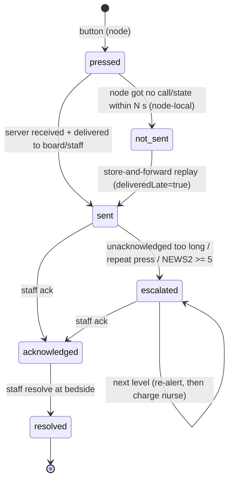

# MQTT topics (contract v1)

Shared contract. Changes need a PR acknowledged by all three owners and must update, in the same PR: the schema, this file, the simulator, and every affected consumer (see `CLAUDE.md`).

Broker: Mosquitto. **The demo uses TLS 1.3 on 8883 with per-device credentials and topic ACLs** (a device may only publish to its own bed), as HackCure requires and per [ADR 0010](../docs/decisions/0010-security-baseline.md). Plain TCP on 1883 with anonymous access is allowed only for unit tests and local development.

## Topics

| Topic | Schema | Publisher | Subscribers | QoS | Retained |
|---|---|---|---|---|---|
| `borj/{ward}/{bed}/vitals` | `vitals.schema.json` | gateway (device), server (manual entry via REST), simulator | server | 1 | no |
| `borj/{ward}/{bed}/device/status` | `device-status.schema.json` | gateway, bedside node, simulator | server | 1 | no |
| `borj/{ward}/{bed}/call` | `call.schema.json` | bedside node, simulator | server | 1 | no |
| `borj/{ward}/{bed}/call/state` | `call-state.schema.json` | **server only** | bedside node, (apps use WebSocket) | 1 | **yes** |
| `borj/{ward}/{bed}/med` | `med.schema.json` | server (from staff app REST), bedside node (patient-reported) | server | 1 | no |
| `borj/{ward}/{bed}/binding` | `binding.schema.json` | server (from staff app REST), simulator | server, gateway | 1 | no |
| `borj/{ward}/staff/{staffId}/ack` | `ack.schema.json` | server (from staff app REST), simulator (background staff) | server | 1 | no |
| `borj/{ward}/staff/{staffId}/presence` | `staff-presence.schema.json` | server (from staff app REST), simulator | server | 1 | no |
| `borj/{ward}/assignment` | `assignment.schema.json` | **server only**, when a charge nurse approves a suggestion | server (event log), apps via WebSocket | 1 | no |
| `borj/{ward}/sim/clock` | `clock.schema.json` | simulator (**demo only**) | server, gateway | 0 | yes |

`staff` and `sim` are reserved and can never be bed ids. `{ward}`, `{bed}` and `{staffId}` in the topic **must equal** the `ward`, `bed` and `staffId` fields in the payload. Consumers reject mismatches.

Apps (board, staff view, family) never talk MQTT. They use the REST/WebSocket API in `openapi.yaml`. The family side never touches the broker at all (safety invariant 3).

## Envelope rules (every message except the demo clock)

- `schemaVersion: 1`, `eventId` (ULID), `ts` (UTC, `Z`), `ward`, `source`, `sourceType`.
- **Idempotency**: QoS 1 is at-least-once, so duplicates will happen. Consumers dedupe by `eventId`; replaying an event changes nothing (invariant 6).
- **Time**: `ts` is when the thing happened, from the device RTC if possible (`tsSource`). Late events (store-and-forward) keep their original `ts`; consumers must handle out-of-order arrival.
- **Absent, not zero**: a parameter a source cannot provide is left out. Never `0`, `null` or `""` as a placeholder (invariant 5).
- **No real patient data**, ever. Ids are synthetic (invariant 7).
- **Integrity** (invariant 13): in the demo, every measurement and call message carries `integrity` = HMAC-SHA256 over the canonical JSON without that field, using a per-device key (`keyId`). Use `borj_contracts.sign()` / `verify()`. Consumers reject and log bad signatures. Gateway adapters additionally verify the device-level checksum or CRC of raw frames.

## Call state machine

The patient button is a **non-authoritative** signal. The staff ack is the authoritative record of a human action. Only the server publishes `call/state`.

Routing and escalation (all timings and thresholds live in server config, not code):

- `assist` calls route to nurses. `comfort` calls route to care assistants first and stay visible to nurses.
- A repeated press (same open `callId`, `pressCount` > 1) escalates.
- A press from a bed whose current NEWS2 is 5 or more escalates immediately.
- Unacknowledged after `ack_timeout_s`: re-alert (level 1). After `escalate_timeout_s`: charge nurse (level 2).

Bedside node feedback (whitepaper 4.2): `pressed` = short beep and LED pulse; `sent` = steady amber; `acknowledged` = green pulse; `not_sent` = fast red blink, local buzzer and a recorded phrase telling the patient to use the emergency bell. **The existing emergency bell always stays in place.**

## Medication

The doctor's prescription is entered over REST and the server creates scheduled doses (`doseId`). Only `doseId` travels on MQTT, never drug names or doses. A nurse `given`/`not_given` closes a dose. A patient's "I took my pills" (`patient_reported_taken`) is stored and shown separately and **never** closes a dose.

## Demo clock

The simulator can run faster than real time. In demo mode the server and gateway use `borj/{ward}/sim/clock.simTs` as "now" for freshness and escalation timers. Real deployments ignore this topic.
