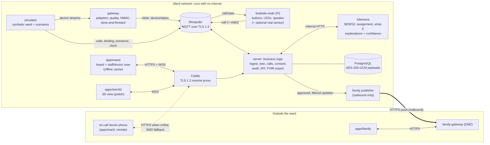

# Architecture

PiCare is a **care-coordination platform for hospital wards** (HackCure **Track 2, Web & Mobile**; see [ADR 0008](decisions/0008-track-2.md)). Bedside signals become a live **digital twin** of the ward. Deterministic, explainable modules then give staff prioritised suggestions. It is **advisory only**: a clinician always validates or rejects.

It is built for public wards, **including regional and district hospitals** with unreliable networks. The ward keeps working with no internet. A **remote on-call doctor** receives escalations, and a premium **Family Care Link** gives relatives consented, nurse-approved updates **without vitals**.

Sources of truth:
- The idea: [`Borj_PiCare_Whitepaper_v2.pdf`](Borj_PiCare_Whitepaper_v2.pdf).
- The competition requirements: [`HackCure_Cahier_des_Charges.pdf`](HackCure_Cahier_des_Charges.pdf).
- The hard rules: [`../RULES.md`](../RULES.md).

## System diagram



## The four layers (HackCure section 5: strict separation)

| Layer | Service(s) | Owner |
|---|---|---|
| **Frontend** | `apps/ward` (`/board`, `/staff`, `/doctor`), `apps/family`, `apps/twin3d` | C (twin3d: B) |
| **Business logic** | `server/`: ingest and validation, twin, call state machine and escalation, consent, privacy filter, audit, REST/WebSocket API, FHIR export | B |
| **Inference** | `inference/`: NEWS2, assignment (OR-Tools), what-if (SimPy), explanations and confidence indices. Stateless and internal only | B |
| **Database** | `postgres`: event log, audit log (hash-chained), consent, prescriptions. Patient payloads encrypted with AES-256-GCM | B |

The edge and transport services sit around these layers: `simulator`, `gateway`, `bedside-node`, `mosquitto` and `caddy`, all owned by A. `family-gateway` runs in the DMZ and is also A's.

## Components

| Folder | Owner | What it is |
|---|---|---|
| `contracts/` | all three | MQTT topics, JSON Schemas, both OpenAPI specs, FHIR mapping, examples, a Python validation helper. **Everyone depends on this.** |
| `seed/` | A | Synthetic ward layout, device profiles and staff roster. |
| `simulator/` | A | Synthetic ward and scenario replayer: seeded, controllable speed, HMAC-signed messages. |
| `gateway/` | A | Read-only device adapters, validity and freshness flags, bed binding, store-and-forward, HMAC signing and CRC checks. |
| `bedside-node/` | A | Raspberry Pi call node (buttons, LEDs, speaker), local queue, mock GPIO mode. Optionally a real PPG/temperature sensor. |
| `infra/` | A | Compose (mosquitto, postgres, server, inference, caddy, simulator, gateway, apps, family-gateway), TLS material for local dev, cloud deployment. |
| `server/` | B | Business logic and API (see the layers table). |
| `inference/` | B | Decision engines with rule traces and confidence. |
| `apps/ward/` | C | Board, staff view and doctor view. Mobile-first, offline cache, validation in 3 steps at most. |
| `apps/family/` | C | Relatives' app, served by family-gateway only. |
| `apps/twin3d/` | B | 3D view built from a Blender-baked ward ([ADR 0012](decisions/0012-3d-twin.md)). Polish. |
| `family-gateway/` | A | DMZ service for the Family Care Link. |
| `tests/` | all | Cross-component and safety-invariant tests, including the integration smoke test. |

## The critical triage path ("zero latency")

```
reading or button press → MQTT (TLS) → server ingest → twin → inference NEWS2 → alert → WebSocket → phone → 1-tap ack
```

- It **never leaves the ward network** and has no cloud dependency. The budget is under 1 second from button press to phone, and under 1 second from reading to updated NEWS2. The board shows the measured latency.
- Heavy work stays off this path: what-if, assignment optimisation, the 3D view and the family link.

## Degraded modes (Track 2: tolerance of degraded networks)

| Failure | Behaviour |
|---|---|
| No internet | The whole ward keeps working. The family link and the remote doctor queue their messages until the connection returns. |
| Wi-Fi drop at a bed | The node shows `not_sent`, plays the "use the emergency bell" phrase, queues the press and replays it later (`deliveredLate`). |
| Broker or server restart | The gateway and nodes store and forward. The twin is rebuilt from the event log, and duplicates are ignored. |
| Inference service down | Scores show as "unavailable" (never guessed). Calls and escalation keep working. |
| Staff phone offline | The app shows the last snapshot marked "offline since …" and queues acks. Critical alerts escalate to someone else. |
| Remote doctor on a poor connection | Escalations are sent by SMS as a fallback. Instructions are queued. |

## Security and privacy (HackCure sections 4–5; [ADR 0010](decisions/0010-security-baseline.md))

- **In transit:** TLS 1.3 everywhere (MQTT 8883, HTTPS/WSS via Caddy).
- **At rest:** AES-256-GCM on patient payloads.
- **Pseudonymisation:** synthetic ids only.
- **Non-repudiation:** real login, every access logged, the audit log hash-chained.
- **Frame integrity:** HMAC-SHA256 per device.
- **Family link:** outbound-only, allow-list, consent first.

## Interoperability and explainability ([ADR 0011](decisions/0011-interop-and-confidence.md))

- A read-only **FHIR R4 export** (`Patient`, `Encounter`, `Observation` with LOINC codes, `MedicationAdministration`). See [`contracts/fhir-mapping.md`](../contracts/fhir-mapping.md).
- Every algorithmic output carries a **confidence index** and an **explanation** (the triggering parameters). The UI labels it advisory, and validating it takes 3 steps at most.

## Deployment (HackCure deliverable L2 and robustness rule)

| Mode | Use |
|---|---|
| **Hosted** | A small cloud VM with a domain and a real TLS certificate. This is the "active web URL" deliverable. |
| **Local** | `docker compose up` on the demo laptop with a local test database and a local CA. This is the main live demo, because it doesn't depend on the venue network. |
| **Backup access point** | A travel router or phone hotspot that the laptop, Pi and phones all join. |

## Key design choices

- **Contracts first.** Every message has `eventId` (ULID), `ts` (UTC), `source` and an optional HMAC `integrity` field. Absent means absent, never zero.
- **Event log = source of truth.** The twin is rebuilt from it, so live state always equals a replay.
- **Deterministic engines.** Thresholds and timers live in config, each marked with who must validate it.
- **Human in the loop.** Suggestions, family updates and doctor instructions are drafts until a named clinician acts. Everything is audited.
- **Demo clock.** The simulator can run faster than real time, and the server uses `sim/clock` as "now" in demo mode.

Decision records: [`decisions/`](decisions/).
