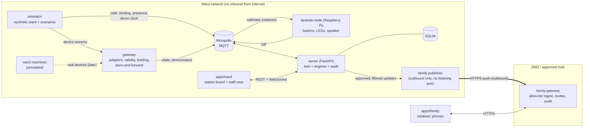

# Architecture

Borj-PiCare is a **Ward Control Tower** for one hospital ward. Bedside signals become a live **digital twin** of the ward. Deterministic modules then give staff prioritised, explainable suggestions. It is **advisory only**: a human always decides. A premium **Family Care Link** gives relatives consented, nurse-approved updates **without vitals**.

Source of truth for the idea: [`Borj_PiCare_Whitepaper_v2.pdf`](Borj_PiCare_Whitepaper_v2.pdf). Hard rules: section "Safety invariants" in [`../CLAUDE.md`](../CLAUDE.md).

## System diagram

Arrows into `family-gateway` only ever start on the ward side. `family-gateway` and `apps/family` cannot reach the broker or the server (safety invariant 3). This is enforced by separate docker networks, and a test will check it.

## Components

| Folder | Owner | What it is |
|---|---|---|
| `contracts/` | all three | MQTT topics, JSON Schemas, OpenAPI for the server and family-gateway, example payloads, a small Python validation helper. **Everyone depends on this.** |
| `seed/` | A | Synthetic ward layout (rooms, beds, positions, device profiles) and staff roster, shared by the simulator and the server. |
| `simulator/` | A | Synthetic ward and scenario replayer (Python). It emits device streams to the gateway and calls, binding, presence and the demo clock to MQTT. Speed is controllable and runs are seeded and reproducible. |
| `gateway/` | A | Ward gateway (runs on a laptop, or on the Pi). Device adapter interface, one replay adapter, validity and freshness flags, bed binding, store-and-forward with unique event ids. Read-only towards devices. |
| `bedside-node/` | A | Raspberry Pi bedside node: assist and comfort buttons, LED states driven by `call/state`, pre-recorded phrases on the speaker, local store-and-forward. Mock GPIO mode for laptops. |
| `infra/` | A | `docker-compose.yml` (Mosquitto, server, simulator, gateway, apps, family-gateway), Mosquitto config, networks. |
| `server/` | B | FastAPI. `twin/` holds the state store and idempotent event handlers. `engines/` holds `news2`, `calls`, `assignment` (OR-Tools), `whatif` (SimPy), `meds`, `explain` and `family` (privacy filter and outbound publisher). Also the audit log and the REST/WebSocket API in `contracts/openapi.yaml`. |
| `family-gateway/` | A | DMZ service in `contracts/family-gateway.openapi.yaml`: allow-list ingest, invite redeem (QR plus one-time code), sessions, rate limits, view audit. |
| `apps/ward/` | C | One React/Vite web app with two routes: `/board` (big screen) and `/staff` (phone: alerts, ack, fast entry, approvals, medication, what-if panel). |
| `apps/family/` | C | Separate React/Vite build for relatives. Talks only to family-gateway. |
| `tests/` | all | Cross-component and safety-invariant tests. |

## Data flow for the vertical slice (phase P1)

1. The simulator emits a raw device stream for bed B06. The gateway's replay adapter parses it, adds quality flags, and publishes `borj/W1/B06/vitals`.
2. The server validates the message against `vitals.schema.json`, dedupes it by `eventId`, and updates the twin.
3. The NEWS2 engine recomputes the score from **fresh, valid** parameters only. Missing or stale ones are listed and the score is labelled partial.
4. The server pushes a `bed` message on the WebSocket. The board shows the score, the reasons and any stale warnings.

## Key design choices

- **Contracts first.** Every message has `eventId` (ULID), `ts` (UTC) and `source`. Absent means absent, never zero. See [`contracts/mqtt-topics.md`](../contracts/mqtt-topics.md).
- **Deterministic engines.** NEWS2 thresholds, escalation timers and what-if parameters live in config files, each marked with who must validate it.
- **Human in the loop.** Assignment suggestions and family updates are only drafts until a named staff member approves them. Every suggestion and decision goes to the audit log.
- **Demo clock.** The simulator can run faster than real time. The server uses `borj/{ward}/sim/clock` as "now" in demo mode.
- **Outbound-only family link.** A publisher with no listening port pushes allow-listed payloads to family-gateway.

Decision records: [`decisions/`](decisions/).
