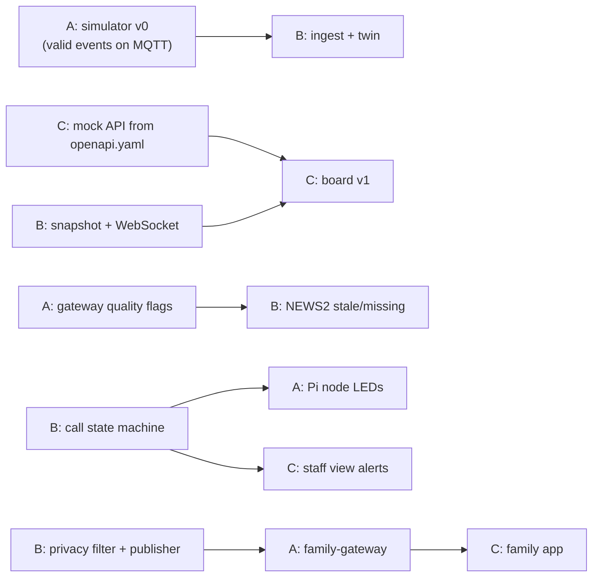

# Team plan

Three roles, few overlaps. **Pick a role, put your GitHub username in [`.github/CODEOWNERS`](../.github/CODEOWNERS) and in the table below, then start with your role's first task.**

| Role | Area | Owns | Sheet | Taken by |
|---|---|---|---|---|
| **A** | Edge and data: "how reality gets in" | `simulator/`, `gateway/`, `bedside-node/`, `infra/`, `seed/`, `family-gateway/`, `contracts/schemas` + `mqtt-topics.md` | [roles/A-edge.md](roles/A-edge.md) | _open_ |
| **B** | Brain: "what the system decides" | `server/` (twin, engines, API, audit, family privacy filter and publisher), `contracts/openapi.yaml` | [roles/B-brain.md](roles/B-brain.md) | _open_ |
| **C** | Interfaces and story: "what people see and believe" | `apps/ward`, `apps/family`, `docs/demo-script.md`, pitch deck lead | [roles/C-interfaces.md](roles/C-interfaces.md) | _open_ |

Shared by everyone: reviews of `contracts/`, `tests/` (safety invariants), demo rehearsals, the deck and BMC, the clinician sanity check.

## What exists already (P0 done by setup)

- Architecture: [ARCHITECTURE.md](ARCHITECTURE.md), decisions in [decisions/](decisions/), assumptions in [ASSUMPTIONS.md](ASSUMPTIONS.md).
- **Contracts v1**: [`contracts/`](../contracts/), with MQTT topics, 13 JSON Schemas with examples, the ward server OpenAPI and the family-gateway OpenAPI.
- Synthetic ward layout and roster: [`seed/ward-W1.yaml`](../seed/ward-W1.yaml).
- Scenario specs: [`simulator/scenarios/`](../simulator/scenarios/). These are data files only, and the simulator code is not written yet.
- Mosquitto in `infra/docker-compose.yml`. CI validates contracts on every PR.
- A README per folder saying what goes there.

**No feature code exists yet.** Each role's first task builds its own skeleton against the contracts, so nobody waits on anybody.

## Scope cut line

| | Items |
|---|---|
| **Must** | simulator → gateway → MQTT → twin → NEWS2 → board; call state machine with escalation; staff view alert and ack |
| **Should** | OR-Tools assignment with human approval; SimPy what-if panel; medication timeline; Pi bedside node (hardware is available) |
| **Could** | Family Care Link thin slice (needed for the business story, so aim for it); Web Push; explainer polish |
| **Won't (now)** | real device integrations, real patient data, hospital SSO, anything that picks drugs or doses, equipment reminders, local LLM, 3D/Omniverse |

## Phases (no dates, done in order)

At the end of each phase, run a 30-minute integration checkpoint: all three demo `main` together.

| Phase | Goal | Exit criteria | A | B | C |
|---|---|---|---|---|---|
| **P0 Foundation** | Everyone can work independently | `docker compose up` shows simulated events flowing; server and apps skeletons build; CI green | simulator v0 emitting valid events; compose | server skeleton, ingest + dedupe | app scaffolds against a mock API |
| **P1 Vertical slice** | One bed end to end | simulated vitals → gateway → MQTT → twin → NEWS2 → board shows score, reasons, stale/missing warning | gateway: adapter, validity, freshness, binding, store-and-forward | twin, NEWS2, snapshot + WebSocket, manual entry | board v1 (2D floor plan), fast-entry form |
| **P2 Calls and staff** | Calls reach a phone and escalate | button press reaches phone, ack works, unacknowledged call escalates, `not_sent` visible | Pi bedside node; peak scenario polish | call state machine, routing, escalation timers, alerts | staff view: alerts, ack/resolve, escalation ladder, sound |
| **P3 Decisions** | Assignment and what-if | overloaded night gives a suggestion with reasons; what-if compares staffing with uncertainty; approval logged | medication and prescription seed data; ward layout distances | OR-Tools assignment, SimPy what-if (Erlang-C oracle), medication timeline, explainer | approval UI, what-if panel, medication timeline view |
| **P4 Family link** | Thin working slice | invite → consent → nurse-approved update visible in the family app; invariant tests green | family-gateway service + network isolation | consent, privacy filter, outbound publisher | family app, nurse invite/approval screens |
| **P5 Polish and pitch** | Demo-ready | demo script rehearsed twice on a clean machine; backup video recorded | clean-machine install test, integration survey template | seed/reset script, performance | demo script, deck lead, recording |

## Hand-offs between roles

Until the real thing exists, everyone works against **contract examples and mocks**: C mocks the API from `openapi.yaml`, B feeds `contracts/examples/*.json` into ingest tests, and A validates everything it emits against the schemas.

## Definition of done for the demo

1. `docker compose up` on a fresh laptop starts everything within a few minutes.
2. The "night-shift-peak" scenario runs end to end:
   - one patient deteriorates and the board shows the NEWS2 rise with reasons;
   - a call goes unacknowledged and escalates;
   - the system suggests a re-assignment and the charge nurse approves it;
   - the what-if panel shows the wait-time effect of a staffing change.
3. The family app shows an approved update for a consenting relative and **never** shows vitals or scores. The filter is demonstrated live.
4. The pitch includes the honest real-vs-simulated slide, the device-integration plan, the legal and consent posture, the premium model and the risks.
5. A backup screen recording exists.

## Working rules (summary; full rules in [CLAUDE.md](../CLAUDE.md))

- `main` is always demo-able. Use short branches `a/...`, `b/...`, `c/...` and merge via a PR with one review.
- A contract change updates the schema, the docs, the simulator and the consumers in the same PR (or linked PRs), and needs all three acknowledgements.
- Every PR adds or updates tests, breaks no invariant test, and includes a screenshot for UI changes.
- Record non-obvious decisions as ADRs in `docs/decisions/`.
- Daily 10-minute stand-up: what I finished, what blocks me, what I need from someone.

## Risks to watch

- **Scope creep** into real device protocols or LLM features: hold the cut line.
- **Integration surprises**: avoid them with contracts and the simulator first.
- **Clinical credibility**: get a clinician to look at thresholds and wording, and never claim diagnosis.
- **Over-claiming**: the twin compares scenarios and does not predict patient outcomes.
- **Demo fragility**: pin versions, ship a seed/reset script, keep a recording.
