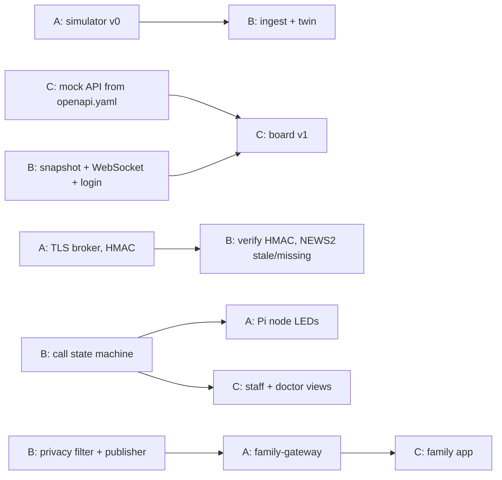

# Team plan

HackCure **Track 2 (Web & Mobile)**: a care-coordination platform for hospital wards that keeps working on degraded networks, with zero-latency triage ([ADR 0008](decisions/0008-track-2.md)).

**To join: pick an open role, put your GitHub username in [`.github/CODEOWNERS`](../.github/CODEOWNERS) and in the table below, then start with your role's first task.**

| Role | Area | Owns | Sheet | Taken by |
|---|---|---|---|---|
| **A** | Edge, transport and deployment: "how reality gets in, safely" | `simulator/`, `gateway/`, `bedside-node/`, `infra/` (compose, TLS broker, Caddy, cloud VM), `seed/`, `family-gateway/`, `contracts/schemas` + `mqtt-topics.md` | [roles/A-edge.md](roles/A-edge.md) | _open_ |
| **B** | Brain: "what the system knows and decides" | `server/` (business logic, twin, security, API, FHIR), `inference/` (NEWS2, assignment, what-if), database, `apps/twin3d`, `contracts/openapi.yaml` + `fhir-mapping.md` | [roles/B-brain.md](roles/B-brain.md) | **@llamauser** |
| **C** | Interfaces and story: "what people see and believe" | `apps/ward` (board, staff, doctor), `apps/family`, `docs/demo-script.md`, `docs/deployment-dossier.md`, pitch lead | [roles/C-interfaces.md](roles/C-interfaces.md) | _open_ |

Shared by everyone:
- Reviews of `contracts/`.
- `tests/` (safety invariants).
- Demo rehearsals and the technical-defence preparation.
- The deck, the BMC, the clinician sanity check.
- **Everyone must be able to explain their part's code, libraries and data pipeline** (see below).

## What HackCure requires (summary of the specification)

| Area | Requirement | Where it's handled |
|---|---|---|
| Security | TLS 1.3 in transit, AES-256 at rest, pseudonymisation, non-repudiation of access | [ADR 0010](decisions/0010-security-baseline.md): A (broker, proxy), B (server) |
| Architecture | Strict separation of frontend, business logic, inference and database; degraded/offline mode | [ADR 0009](decisions/0009-layers-and-postgres.md); offline behaviour in [ARCHITECTURE](ARCHITECTURE.md) |
| Interoperability | Structured JSON, compatible with HL7/FHIR | Contracts + FHIR export ([ADR 0011](decisions/0011-interop-and-confidence.md)) |
| Ergonomics | Validate an alert or an order in **3 steps at most**, low cognitive load | C, hard acceptance criterion |
| IoT | MQTT, integrity check on measurement frames | A: HMAC + CRC |
| Explainability | Measurable **confidence index** + explanation for every algorithmic output; no black box | B (inference), C (display) |
| Human in the loop | An explicit validate/reject step; the UI says clearly that it's advisory | B (audit), C (UI) |
| Business | Who pays, access barriers, realistic server and hardware costs | C leads the deployment dossier |
| **L1** | Public repo, clear history, **exhaustive README** (local install, dependencies) | Everyone keeps their component README current |
| **L2** | Working MVP, realistic synthetic data, **active web URL** | A: cloud deployment; everyone: features |
| **L3** | Deployment dossier: field feasibility, regulatory compliance, **roadmap at 3 and 6 months** | C leads, [deployment-dossier.md](deployment-dossier.md) |
| Live demo | 1. Clinical case → 2. live MVP (**no video, no mockup**) → 3. technical defence | [demo-script.md](demo-script.md) |
| Robustness | Self-contained Docker setup, local test database, **backup access point** | A |

## Scope cut line

| | Items |
|---|---|
| **Must** | Simulator → gateway → MQTT (TLS) → twin → NEWS2 with confidence → board; call state machine with escalation; staff view alert and 1-tap ack; real login and access audit; encryption in transit and at rest; offline/degraded behaviour; latency measured on the board; Docker + hosted URL |
| **Should** | Remote on-call doctor view (telemedicine); OR-Tools assignment with human approval; SimPy what-if; medication timeline; Pi bedside node; FHIR export; real sensor on the Pi (if the team agrees) |
| **Could** | Family Care Link thin slice (needed for the business story, so aim for it); 3D twin; Web Push; SMS fallback |
| **Won't (now)** | Real device integrations beyond one optional sensor, real patient data, hospital SSO, anything that picks drugs or doses, equipment maintenance, local LLM, Omniverse/Unreal, writing into a real hospital information system |

## Phases (no dates, done in order)

At the end of each phase, run a 30-minute integration checkpoint: everyone demos `main` together.

| Phase | Goal | Exit criteria | A | B | C |
|---|---|---|---|---|---|
| **P0 Foundation** | Everyone can work independently | `docker compose up` shows simulated events flowing into the server; app skeletons build; CI green | simulator v0, compose | server skeleton: event log, twin, ingest, snapshot (**done, PR #1**) | app scaffolds against a mock API |
| **P1 Vertical slice** | One bed end to end, securely | vitals → gateway → MQTT (TLS) → twin → NEWS2 (+ confidence, reasons) → board, with stale/missing labels; login works | gateway; TLS broker + per-device credentials; HMAC | PostgreSQL + encryption at rest; `inference/` with NEWS2; login + access audit; WebSocket | board v1 (2D floor plan), login, fast entry |
| **P2 Calls, staff, resilience** | Calls reach a phone, escalate, and survive network cuts | button → phone under 1 s (measured), ack, escalation, `not_sent`; **live network cut** works | Pi node; network-cut drill; backup access point | call state machine, escalation, latency metric, offline queue on the server side | staff view, escalation ladder, offline cache + queued acks |
| **P3 Decisions and telemedicine** | Coordination tools | assignment suggestion with reasons and confidence, approved in 3 steps or fewer; what-if with p5–p95; remote doctor gets an escalation and replies | seed prescriptions, ward distances | assignment, what-if (Erlang-C oracle), meds timeline, doctor instructions, FHIR export | approval UI, what-if panel, meds view, doctor view |
| **P4 Family link** | Thin working slice | invite → consent → approved update in the family app; invariant tests green | family-gateway + network isolation | consent, privacy filter, outbound publisher | family app, invite/approval screens |
| **P5 Delivery** | Demo-ready, deliverables done | hosted URL live; demo rehearsed twice on a clean machine; L3 dossier done; README exhaustive | cloud deployment hardening, clean-machine test | seed/reset script, performance; 3D twin if time allows | deployment dossier, deck, Q&A rehearsal |

## Hand-offs between roles

Until the real thing exists, everyone works against **contract examples and mocks**.

## Definition of done (matches the HackCure demo protocol)

1. **Clinical case (step 1):** the night-shift story on a regional ward is told in under a minute.
2. **Live MVP (step 2)**, on the local Docker setup with the backup access point:
   - a patient deteriorates and the board shows the NEWS2 rise with its reasons and confidence;
   - a bedside call goes unacknowledged and escalates to the charge nurse and the remote doctor;
   - **the network is cut live and the ward keeps working**, then catches up;
   - an assignment suggestion is approved in 3 steps or fewer;
   - the what-if panel shows the effect of a staffing change;
   - the family app shows an approved update and never shows vitals or scores.
3. **Technical defence (step 3):** everyone can explain their component choices, scalability, fault resilience and data governance.
4. **Deliverables:** public repo with an exhaustive README (L1), hosted URL working (L2), deployment dossier with the 3- and 6-month roadmap (L3).

## Working rules (summary; full rules in [CLAUDE.md](../CLAUDE.md))

- `main` is always demo-able. Use short branches `a/...`, `b/...`, `c/...` and merge via a PR with one review.
- A contract change updates the schema, docs, simulator and consumers together, and needs all three acknowledgements.
- Every PR adds or updates tests, breaks no invariant test, and includes a screenshot for UI changes.
- **Understand what you merge.** HackCure warns that teams must explain generated code in detail. Read every PR in your area, and keep the "why" in READMEs and ADRs.
- Commits and PRs are made under each member's own GitHub account, without AI attribution lines.
- Daily 10-minute stand-up.

## Risks to watch

- **Scope creep:** hold the cut line, and put security and resilience before polish.
- **Live-demo failure:** no video fallback is allowed, so rehearse on the local setup with the backup access point.
- **Unexplainable code:** review and document as you go.
- **Clinical credibility:** a clinician should look at the thresholds and wording, and the system never claims to diagnose.
- **Over-claiming:** the twin compares scenarios and does not predict outcomes; the confidence reflects data quality, not certainty about the patient.
